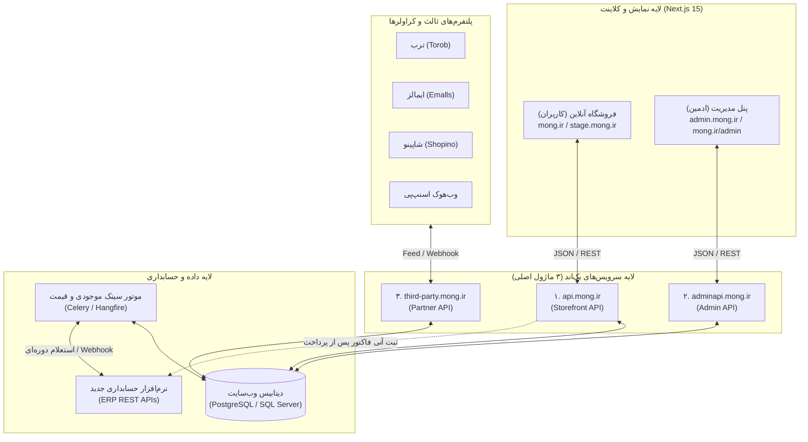

# فصل ۱: معماری جامع سیستم (System Architecture)

## ۱. نمای کلی توپولوژی سیستم (Current vs Target)

سیستم فروشگاه منگ بر پایه تفکیک مسئولیت‌ها (Separation of Concerns) و معماری چند سرویسی شکل گرفته است. در وضعیت فعلی، سیستم به دیتابیس نرم‌افزار قدیمی PTC متصل است؛ در معماری هدف، بک‌اند جنگو نقش واسط هوشمند میان سایت و ERP جدید را ایفا خواهد کرد.

---

## ۲. معرفی ۳ ماژول کلیدی بک‌اند

بک‌اند پلتفرم از سه سرویس کاملاً مستقل تشکیل شده که هر کدام مخاطب و نیازمندی‌های امنیتی متفاوتی دارند:

### ۲.۱. ماژول اول: وب‌سرویس عمومی مشتریان (`api.mong.ir`)
* **دامنه/مسیر:** `https://api.mong.ir/api/v1`
* **مخاطب:** کاربران عمومی وب‌سایت، سبد خرید، کاتالوگ محصولات و درگاه‌های پرداخت.
* **احراز هویت:** بدون نیاز به احراز هویت برای دیدن محصولات؛ برای سبد خرید و سفارشات: توکن JWT از طریق شماره موبایل و کد یکبار مصرف (SMS OTP).
* **مسئولیت‌ها:**
  * ارائه لیست محصولات، فیلترها (سایز، رنگ، دسته‌بندی)، جزئیات کالا و موجودی زنده.
  * ارسال پیامک لاگین و اعتبارسنجی OTP.
  * مدیریت سبد خرید (Cart)، انتخاب روش ارسال و ثبت اولیه فاکتور.
  * ارتباط با درگاه‌های پرداخت اینترنتی (زرین‌پال، سداد و اسنپ‌پی اعتباری).
  * ثبت آدرس‌های کاربر، علاقه‌مندی‌ها و نظرات.

---

### ۲.۲. ماژول دوم: وب‌سرویس پنل مدیریت (`adminapi.mong.ir`)
* **دامنه/مسیر:** `https://adminapi.mong.ir/api/v1`
* **مخاطب:** پرسنل انبار، مدیران سایت، پشتیبانی و اپراتورهای فروشگاه.
* **احراز هویت:** توکن JWT مبتنی بر لاگین نام کاربری/رمز عبور ادمین با قابلیت Refresh Token دوره‌ای.
* **مسئولیت‌ها:**
  * مدیریت وضعیت فاکتورها (تایید، در حال آماده‌سازی، ارسال شده، لغو شده).
  * مدیریت کاتالوگ (تعریف برچسب‌ها، توضیحات سئو، اسلایدرها و بنرهای تبلیغاتی).
  * آپلود و مدیریت تصاویر/ویدیوها در گالری مدیا (CDN).
  * تعریف کوپن‌های تخفیف و کارت‌های هدیه.
  * تایید یا رد نظرات ثبت‌شده کاربران روی کالاها.
  * آمار و داشبورد تحلیلی فروش روزانه، ماهانه و گزارش‌های کلیک ترب.

---

### ۲.۳. ماژول سوم: سرویس همکاران و پلتفرم‌های خارجی (`third-party.mong.ir`)
* **دامنه/مسیر:** `https://third-party.mong.ir/api/`
* **مخاطب:** پلتفرم‌های مقایسه قیمت (ترب، ایمالز)، پلتفرم‌های بازارگاهی (شاپینو / Shopino) و وب‌هوک‌های ارائه‌دهندگان سرویس اعتباری (اسنپ‌پی).
* **امنیت و دسترسی:** محافظت‌شده از طریق **IP Whitelisting** و کلیدهای داخلی (`InternalKey`).
* **مسئولیت‌ها:**
  * **فید کراولر (Crawler Feed):** ارائه لیست کامل کالاها به همراه قیمت جاری، قیمت تخفیف‌خورده، وضعیت موجود بودن، و تنوع‌های رنگ و سایز جهت خزش خودکار ربات‌های ترب و ایمالز.
  * **ارائه جزئیات تکی کالا (`ProductInfo`):** استعلام لحظه‌ای مشخصات کالا بر اساس شناسه.
  * **وب‌هوک ثبت سفارش شاپینو (`ShopinoInvoiceWebhook`):** هنگامی که مشتری در پلتفرم شاپینو سفارشی ثبت می‌کند، شاپینو از طریق وب‌هوک سفارش را به این ماژول می‌فرستد تا فاکتور ساخته شود.
  * **وب‌هوک تسویه و تایید اسنپ‌پی:** دریافت سیگنال‌های مالی و تایید اقساط کاربر.

---

## ۳. پایگاه‌های داده و مکانیزم همگام‌سازی (Data Pipeline)

### وضعیت فعلی (داده‌فا + PTC)
در سیستم فعلی دو دیتابیس مجزا وجود دارد:
1. `DadehfaOnlineShop`: دیتابیس میانی وب‌سایت (جداول کالاها، عکس‌ها، فاکتورها، کاربران).
2. `PTCERPNew`: دیتابیس نرم‌افزار حسابداری صندوق در فروشگاه.
جاب‌های Hangfire در بک‌اند با بازه‌های ۵ دقیقه‌ای به دیتابیس PTC وصل شده و داده‌ها را سینک می‌کردند.

### معماری جدید با ERP جدید و جنگو
در معماری جدید نیازی به دسترسی مستقیم به دیتابیس حسابداری نیست؛ بلکه:
1. دیتابیس وب یک پایگاه‌داده‌ی مستقل و پرسرعت (ترجیحاً PostgreSQL) است.
2. با استفاده از **Celery Worker** و **Celery Beat**:
   * هر چند دقیقه یک‌بار، تغییرات موجودی و قیمت از طریق API رسمی نرم‌افزار جدید استعلام می‌شود.
   * به محض پرداخت موفق در سایت، سفارش بلافاصله از طریق API فاکتورِ ERP جدید ثبت شده و موجودی انبار کسر می‌گردد.
