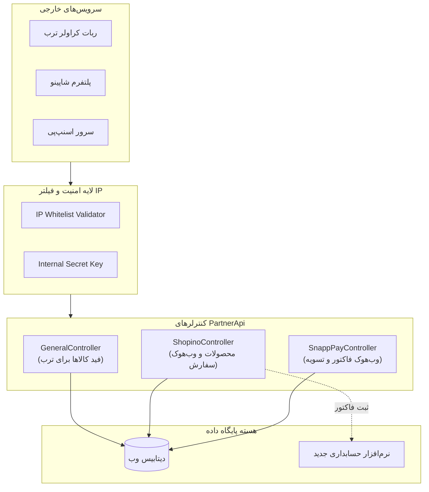

# فصل ۴: سرویس همکاران و خزشگرها (`third-party.mong.ir`)

این سند مشخصات فنی و معماری ماژول `third-party.mong.ir` (که در پروژه فعلی با نام `Dadehfa.General.WebSite.PartnerApi` کامپایل شده) را تشریح می‌کند.

---

## ۱. فلسفه وجودی و مخاطبان این ماژول

ماژول Third-Party یا Partner API در فروشگاه منگ یک درگاه اختصاصی برای تعامل با پلتفرم‌های بیرونی است. این ماژول سه وظیفه حیاتی دارد:
1. **خزشگرهای قیمت (Price Crawlers):** ارائه فید خودکار به پلتفرم‌های ترب (Torob) و ایمالز (Emalls) جهت به‌روزرسانی لحظه‌ای قیمت‌ها و عدم جریمه فروشگاه به دلیل مغایرت قیمت.
2. **پلتفرم بازارگاهی شاپینو (Shopino):** ارائه لیست کالاها به اپلیکیشن شاپینو و دریافت سفارش‌های ثبت‌شده در شاپینو از طریق وب‌هوک.
3. **وب‌هوک‌های مالی اسنپ‌پی (SnappPay):** تاییدیه تراکنش‌ها و تسویه‌حساب خریدهای اقساطی.



---

## ۲. مکانیزم امنیت و اعتبارسنجی (Security & Whitelist)

همان‌طور که در فایل [third-party.mong.ir/appsettings.json](file:///mnt/sda2/backup_example.com_2610172039/backup_user-data_2610172039/third-party.mong.ir/appsettings.json) تعریف شده است، این سرویس دارای لایه‌های امنیتی زیر است:

### ۲.۱. لیست سفید آی‌پی (IP Whitelist)
درخواست‌های ارسالی به وب‌هوک‌های حساس (مانند اسنپ‌پی و شاپینو) باید تنها از رنج آی‌پی‌های مجاز سرورهای آن‌ها باشد:
* **آی‌پی‌های مجاز اسنپ‌پی:**
  * `185.206.93.115`, `185.206.94.25`, `37.152.176.176`, `188.121.106.231`, `217.218.127.127`, `217.218.155.155`, `185.161.112.33`, `185.161.112.34`, `5.202.100.100`, `2.189.44.44`
* **قانون پیاده‌سازی در جنگو:** ایجاد یک Middleware ساده به نام `PartnerIPWhitelistMiddleware` که آی‌پی ریموت درخواست را با لیست فوق تطبیق دهد و در صورت عدم تطابق، خطای `403 Forbidden` برگرداند.

### ۲.۲. کلید محرمانه داخلی (Internal Key)
* **کلید:** ``
* در هدر درخواست‌های ورودی به عنوان `X-Internal-Key` یا توکن بررسی می‌شود.

---

## ۳. مشخصات اندپوینت‌های کراولر ترب و عمومی (`GeneralController`)

### ۳.۱. فید لیست محصولات (Product List Feed)
* **مسیر:** `GET /api/General/ProductList`
* **هدف:** کراولر ترب با دوره‌های زمانی مشخص (مثلاً هر ۳۰ دقیقه) این اندپوینت را فراخوانی می‌کند تا لیست کلیه محصولات موجود را دریافت کند.
* **فرمت خروجی استاندارد ترب:**
  ```json
  [
    {
      "product_id": 450,
      "page_url": "https://mong.ir/products-item/shomiz-linen-ipek-450",
      "price": 14500000,
      "old_price": 23870000,
      "availability": "instock",
      "title": "شومیز لینن راه راه ایپک - صورتی",
      "image_links": [
        "https://cdn.mong.ir/products/p450_1.webp",
        "https://cdn.mong.ir/products/p450_2.webp"
      ],
      "category_name": "شومیز",
      "guarantee": "اصالت و سلامت فیزیکی کالا",
      "spec": {
        "رنگ": "صورتی",
        "سایز": "FreeSize",
        "جنس": "لینن"
      }
    }
  ]
  ```

### ۳.۲. استعلام لحظه‌ای کالا (`ProductInfo`)
* **مسیر:** `GET /api/General/ProductInfo?productId=450`
* **هدف:** وقتی کاربری در ترب روی دکمه "خرید" کلیک می‌کند، ترب بلافاصله قبل از هدایت کاربر به سایت این API را صدا می‌زند تا مطمئن شود کالا در همین ثانیه ناموجود یا گران نشده باشد.
* **خروجی:** اطلاعات دقیق آخرین قیمت و وضعیت موجودی (`isAvailable: true/false`).

---

## ۴. مشخصات سرویس شاپینو (`ShopinoController`)

پلتفرم شاپینو به عنوان یک سوشال‌کامرس (بازارگاه) کار می‌کند که هم کالاهای منگ را نمایش می‌دهد و هم امکان پرداخت درون اپلیکیشن را برای خریداران فراهم می‌کند.

### ۴.۱. دریافت محصولات مخصوص شاپینو
* **مسیر:** `GET /api/Shopino/ShopinoProduct`
* **خروجی:** لیست کالاها به همراه تفکیک دقیق ماتریس تنوع‌ها (رنگ و سایز)، عکس مربوط به هر رنگ و موجودی انبار.

### ۴.۲. وب‌هوک ثبت سفارش شاپینو (`InvoiceWebhook`)
* **مسیر:** `POST /api/Shopino/InvoiceWebhook`
* **کنترلر در کد قبلی:** `ShopinoInvoiceWebhookCommandHandler`
* **فرآیند پردازش:**
  1. شاپینو اطلاعات سبد خرید و مشتری را به صورت JSON به این اندپوینت می‌فرستد.
  2. متد `GetOrCreateCustomerId` شماره موبایل و نام مشتری را در سیستم جستجو می‌کند؛ در صورت نبودن، مشتری جدید می‌سازد.
  3. متد `CreateNewInvoice` پیش‌فاکتور را ایجاد و اقلام، رنگ و سایز را بررسی می‌کند.
  4. متد `CreateFinalizedInvoice` فاکتور را نهایی کرده، وضعیت را به "پرداخت شده از طریق شاپینو" تغییر می‌دهد و جهت کسر از موجودی به ERP اعلام می‌کند.
* **پاسخ برگشتی به شاپینو:**
  ```json
  {
    "isSuccess": true,
    "shopinoInvoiceId": "SHP-892341",
    "webInvoiceId": 9850,
    "status": "Accepted"
  }
  ```

---

## ۵. رهگیری کلیک‌ها و گزارش‌های ورود از ترب (Tracking & Analytics)

در فرانت‌اند کاربر (`torobLogService.ts`)، وقتی مشتری از لینک اختصاصی ترب وارد سایت می‌شود، این اندپوینت صدا زده می‌شود:
* **مسیر:** `POST /api/v1/ThirdPartyLog/AddThirdPartyLog/AddThirdPartyLog`
* **بدنه درخواست:**
  ```json
  {
    "thirdPartyName": "Torob",
    "redirectUrl": "https://mong.ir/products-item/shomiz-450",
    "productVariantId": 450004552,
    "priceBeforeReduction": 23870000,
    "reduction": 39.25,
    "utmSource": "torob",
    "utmMedium": "cpc",
    "utmCampaign": "summer1405"
  }
  ```
* این اطلاعات در جدول لاگ ذخیره شده و در پنل ادمین (فصل ۳) برای رسم نمودارهای تحلیل بازدهی تبلیغات ترب استفاده می‌شود.
